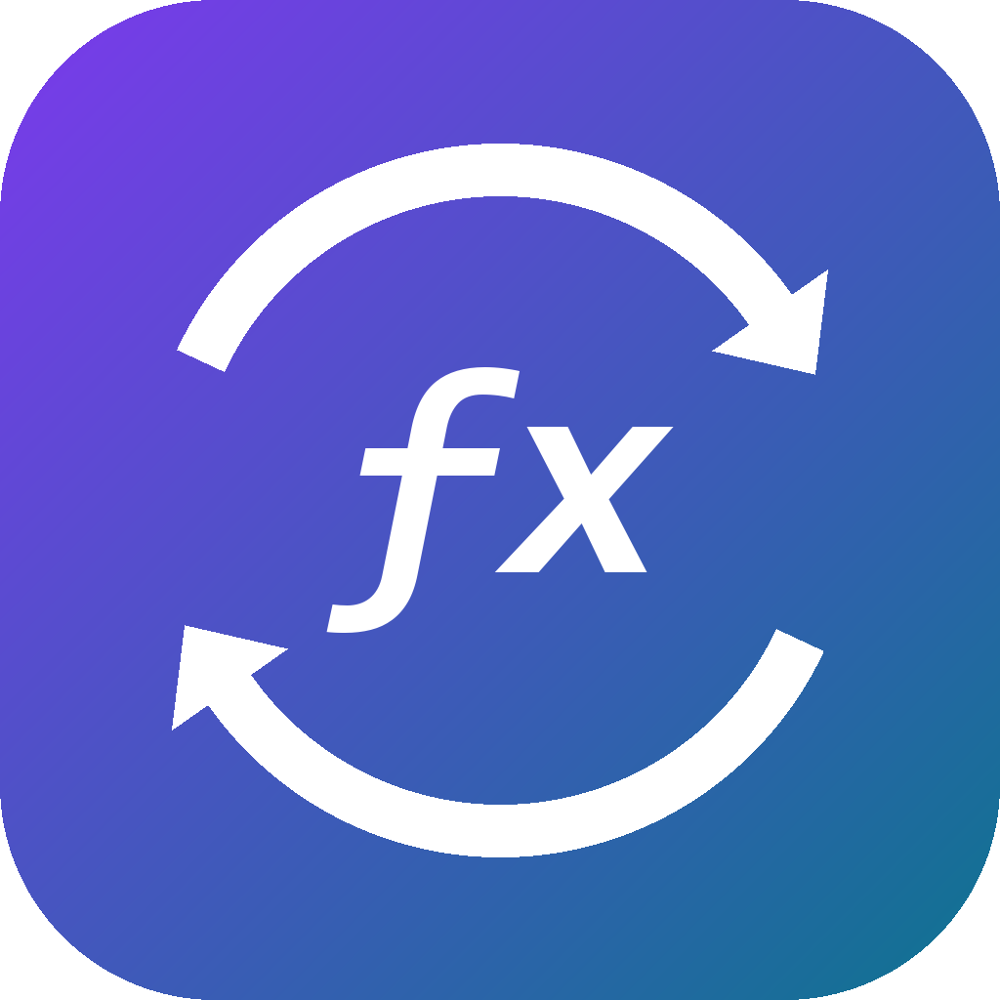
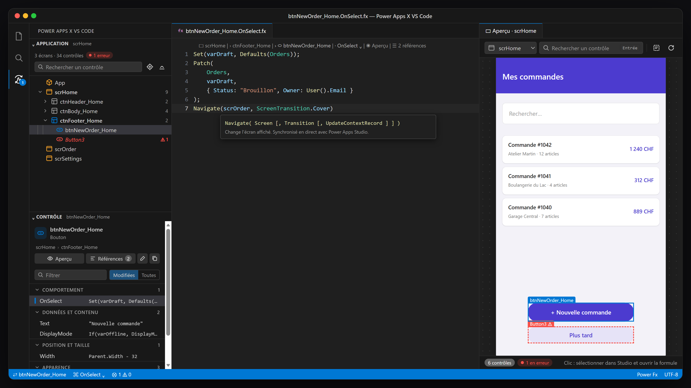
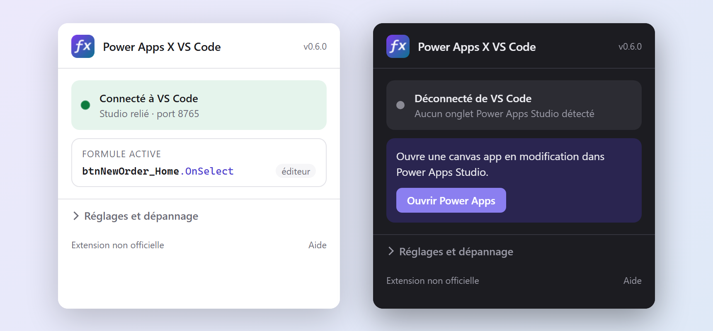
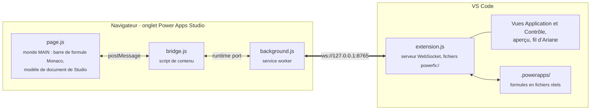

# Power Apps X VS Code

**Écris les formules Power Fx de tes canvas apps dans VS Code, synchronisées en direct avec Power Apps Studio.**

Extension VS Code + extension navigateur (Chrome, Edge, Firefox) · français et anglais · non officielle, non affiliée à Microsoft

Capture réalisée avec les vrais composants de l’extension, sur une app de démonstration.

## Ce que ça change

| | |
|---|---|
| **Édition en direct** | Sélectionne un contrôle dans Studio : sa formule s’ouvre dans VS Code. Chaque frappe part vers Studio (et inversement), avec annuler/rétablir conservé. |
| **Application** | Tous les écrans et contrôles, avec une recherche instantanée, une icône par type, les erreurs en rouge et les noms par défaut en italique. La vue suit la sélection de Studio. |
| **Contrôle** | L’inspecteur du contrôle sélectionné : emplacement cliquable, actions (aperçu, références, renommer) et propriétés groupées par catégorie, avec l’aperçu de chaque formule. Filtre « Modifiées / Toutes ». |
| **Fil d’Ariane** | En haut de chaque formule : `Écran › Conteneur › Contrôle · Propriété`, chaque élément cliquable. |
| **Aperçu de l’écran** | Copie vivante de l’écran de Studio : clique un élément pour ouvrir sa formule, cherche un contrôle, change d’écran. |
| **Langage Power Fx** | Coloration, complétion, aide sur les signatures, survol, formatage (<kbd>Maj</kbd>+<kbd>Alt</kbd>+<kbd>F</kbd>), <kbd>Ctrl</kbd>+clic sur un contrôle pour le sélectionner. |
| **Qualité** | Erreurs de Studio dans la vue Problèmes, recherche dans toutes les formules, références d’un contrôle, renommage par Studio (références mises à jour), analyse des variables, collections et contrôles inutilisés. |
| **Fichiers réels** | Toute l’app est exportée dans `.powerapps/` (une formule par fichier, `_app.json`, `_state.json`). Un outil qui modifie ces fichiers, comme un assistant IA, modifie l’app dans Studio. |

## Démarrage

1. **VS Code** : installe `dist/powerapps-bridge-<version>.vsix` (`code --install-extension …`) ou lance <kbd>F5</kbd> depuis `vscode-extension/`.
2. **Navigateur** : `chrome://extensions` (ou `edge://extensions`), active le mode développeur, puis *Charger l’extension non empaquetée* → `browser-extension/`.
3. Ouvre une canvas app en modification dans [Power Apps Studio](https://make.powerapps.com/), panneau **Arborescence** visible.
4. À la première connexion, VS Code demande d’**autoriser l’extension navigateur** : accepte.

## Raccourcis

| Raccourci | Action |
|---|---|
| <kbd>Ctrl</kbd>+<kbd>Alt</kbd>+<kbd>F</kbd> | Rechercher un contrôle |
| <kbd>Ctrl</kbd>+<kbd>Alt</kbd>+<kbd>P</kbd> | Changer de propriété du contrôle courant |
| <kbd>Ctrl</kbd>+<kbd>Alt</kbd>+<kbd>G</kbd> | Aller à `Contrôle.Propriété` |
| <kbd>Ctrl</kbd>+<kbd>Alt</kbd>+<kbd>Maj</kbd>+<kbd>F</kbd> | Rechercher dans toutes les formules |
| <kbd>/</kbd> | Dans les vues Application et Contrôle : filtrer |
| <kbd>F2</kbd> | Dans la vue Application : renommer le contrôle |

## Architecture

- **Studio → VS Code** : sondage toutes les 200 ms (contrôle sélectionné, propriété, formule). Un changement de sélection ouvre le fichier, une frappe dans Studio met à jour le document.
- **VS Code → Studio** : chaque frappe (anti-rebond de 150 ms) devient un `setFormula`, écrit dans l’éditeur Monaco de Studio avec `executeEdits` (l’historique annuler/rétablir est conservé).
- **Anti-écho** : pendant 1,5 s après une frappe dans VS Code, les mises à jour venant de Studio sont ignorées. Une édition destinée à un autre contrôle que celui affiché dans Studio fait d’abord naviguer Studio vers ce contrôle (réglage `navigateOnEdit`).
- **Export** : à la connexion, chaque écran est lu depuis le modèle de document de Studio (le YAML de « Copier le code »), sans navigation, et écrit dans `.powerapps/`.

## Sécurité

- Le serveur n’écoute que sur `127.0.0.1`. Seules les origines `chrome-extension://` et `moz-extension://` sont acceptées, ce qui exclut les pages web.
- **Appairage** : chaque extension navigateur doit être autorisée une fois dans VS Code. Une autre extension installée dans le navigateur ne peut donc ni lire ni modifier les formules sans ton accord. La commande *Power Apps : Oublier les extensions navigateur autorisées* révoque les autorisations.
- Les messages sont limités à 64 Mo. Les vues de VS Code n’exécutent que leurs propres scripts (CSP à nonce), et l’aperçu de l’écran n’affiche que du HTML et des styles, sans script.
- Aucune donnée ne quitte la machine : voir [PRIVACY.md](PRIVACY.md).

## Packaging et publication

`node scripts/package.mjs` produit dans `dist/` :
- `powerapps-bridge-<version>.vsix` : VS Code Marketplace (`npx @vscode/vsce publish --packagePath <vsix>`) et Open VSX (`npx ovsx publish <vsix> -p <jeton>`) ;
- `powerapps-x-vscode-browser-<version>.zip` : Chrome Web Store, Edge Add-ons, Firefox AMO.

Textes et justifications pour les stores : [store/browser-listing.md](store/browser-listing.md). Garder la même version dans `vscode-extension/package.json` et `browser-extension/manifest.json`.

## Dépannage

<b>Rien ne se passe à la connexion</b>

- Le popup de l’extension navigateur indique l’état de la connexion et l’action à faire.
- Une autre fenêtre VS Code a peut-être déjà pris le port 8765 : VS Code le signale et propose de réessayer ou de changer de port (réglage `powerappsBridge.port`, à reporter dans le popup).
- *Power Apps : Afficher le journal* liste les connexions, l’export et les éditions.

<b>Aperçu de l’écran vide</b>

`page.js` sérialise l’écran courant du canevas (requête `mirror` : sous-arbre de l’élément `[data-control-name]` de l’écran, styles calculés en ligne, sans scripts ni feuilles de style, images converties en `data:` quand c’est possible). `vscode-extension/preview.js` le réaffiche à l’échelle avec un calque cliquable par contrôle. Il est rafraîchi à chaque sélection ou modification, et toutes les 3 s tant que le panneau est visible. Si rien ne s’affiche, le *Diagnostic de la page* (popup › Réglages et dépannage) contient une section `canvas`.

<b>La barre de formule n’est pas détectée</b>

L’interface de Studio n’est pas documentée. Popup → **Analyser la page** → Copier le résultat, puis ajuster `FORMULA_BAR_SELECTORS`, `PROPERTY_SELECTORS` et `SELECTED_CONTROL_SELECTORS` en haut de `browser-extension/page.js`.

Modes de lecture et d’écriture (champ `mode`) :
- `monaco` : instance de l’éditeur trouvée (API `monaco` globale ou parcours des objets React internes). Lecture et écriture fiables.
- `monaco-dom` : instance introuvable. Lecture depuis le DOM ; écriture par sélection de tout puis collage simulé, non garantie.
- `input` / `ce` : la barre de formule n’est pas Monaco.

## Licence

[MIT](LICENSE)
