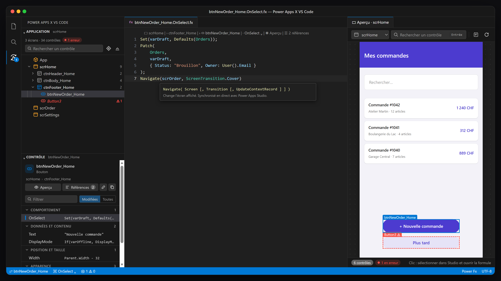

# Power Apps X VS Code

Write the Power Fx formulas of your canvas apps in VS Code, kept in sync live with Power Apps Studio.

> Unofficial project, not affiliated with or endorsed by Microsoft. Power Apps and Visual Studio Code are trademarks of Microsoft.
>
> Available in English and French: the extension follows VS Code's display language.

## What you get

- **Live editing.** Select a control in Studio and its formula opens in VS Code. Every keystroke is written into Studio's formula bar (Studio's undo history is kept), and edits made in Studio show up in VS Code.
- **Application view.** Every screen and control of the app, with an instant filter, one icon per control type, errors in red and default names (Label3…) in italics. It follows the selection in Studio.
- **Control view.** An inspector for the selected control: where it sits (clickable path), actions (preview, references, rename) and its properties grouped by category, each with a preview of its formula. Show only the modified properties, or all of them.
- **Breadcrumb** above each formula: `Screen › Container › Control · Property`, every part clickable.
- **Screen preview.** A live copy of the Studio screen: click an element to open its formula, search for a control, switch screens.
- **Power Fx language support.** Highlighting, completion, signature help, hovers, formatting (`Shift+Alt+F`), `Ctrl+click` a control name to select it in Studio.
- **Code quality.** Studio's formula errors in the Problems panel (and as a badge on the side bar icon), search across all formulas, references of a control, rename through Studio (references updated), clean-up analysis of unused variables, collections and controls.
- **Real files.** The whole app is exported to a `.powerapps/` folder (one file per formula, plus `_app.json` and `_state.json`). Tools that work on files, such as an AI assistant, can read and edit the app: saving a file sends it to Studio.

## Getting started

1. Install this extension.
2. Install the **Power Apps X VS Code** browser extension (Firefox, Chrome or Edge). Builds are attached to each [GitHub release](https://github.com/vDAKK/powerapps-vscode-bridge/releases).
3. Open a canvas app in edit mode in [Power Apps Studio](https://make.powerapps.com/), with the Tree view panel visible.
4. On the first connection, VS Code asks you to **approve the browser extension**: accept.

The status bar then shows the selected control. A walkthrough opens on first install (*Help: Get Started*).

## Shortcuts

| Shortcut | Action |
|---|---|
| `Ctrl+Alt+F` | Search for a control |
| `Ctrl+Alt+P` | Switch property of the current control |
| `Ctrl+Alt+G` | Go to `Control.Property` |
| `Ctrl+Alt+Shift+F` | Search all formulas |
| `/` | Filter, in the Application and Control views |
| `F2` | Rename the control, in the Application view |

All commands are in the command palette under **Power Apps** (for example *Power Apps: Screen preview*).

## Settings

| Setting | Default | Description |
|---|---|---|
| `powerappsBridge.port` | `8765` | Local WebSocket port the browser extension connects to (127.0.0.1 only). Must match the port set in the browser extension. |
| `powerappsBridge.followSelection` | `true` | Open the formula selected in Studio automatically. |
| `powerappsBridge.navigateOnEdit` | `true` | When you edit a formula that Studio is not showing, switch Studio to it before writing. |
| `powerappsBridge.singleTab` | `true` | Keep one formula tab open; pinned tabs are kept. |
| `powerappsBridge.mirrorFolder` | `.powerapps` | Workspace folder with the app as real files. Empty disables it. |
| `powerappsBridge.exportOnConnect` | `true` | Read every formula of the app into that folder when Studio connects. |
| `powerappsBridge.syncFromDisk` | `true` | Send a `.fx` file of that folder to Studio when it is saved. Off makes the folder a read-only copy. |
| `powerappsBridge.lint` | `true` | Report unused variables, collections, named formulas and hidden controls in the Problems panel. |

## Privacy and security

- The WebSocket server listens on `127.0.0.1` only and accepts browser extensions only (`chrome-extension://`, `moz-extension://` origins), never web pages.
- Each browser extension must be approved once in VS Code, so another extension installed in your browser cannot read or change your formulas. The command *Power Apps: Forget approved browser extensions* revokes the approvals.
- No data leaves your computer: formulas travel between your browser and VS Code locally. No telemetry. See the [privacy policy](https://github.com/vDAKK/powerapps-vscode-bridge/blob/main/PRIVACY.md).

## Limitations

Power Apps Studio's interface is not a public API. A Studio update can break the detection of the formula bar or of the selected control until the browser extension is updated. Report issues on [GitHub](https://github.com/vDAKK/powerapps-vscode-bridge/issues).
